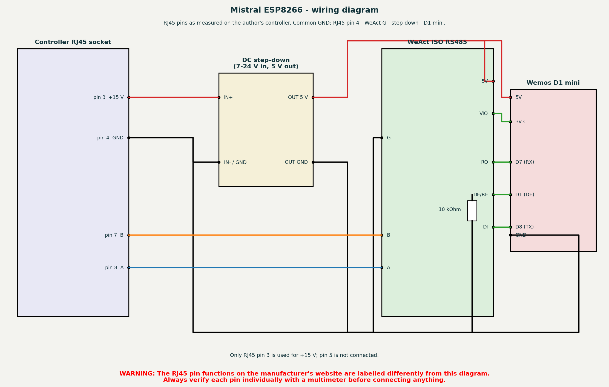
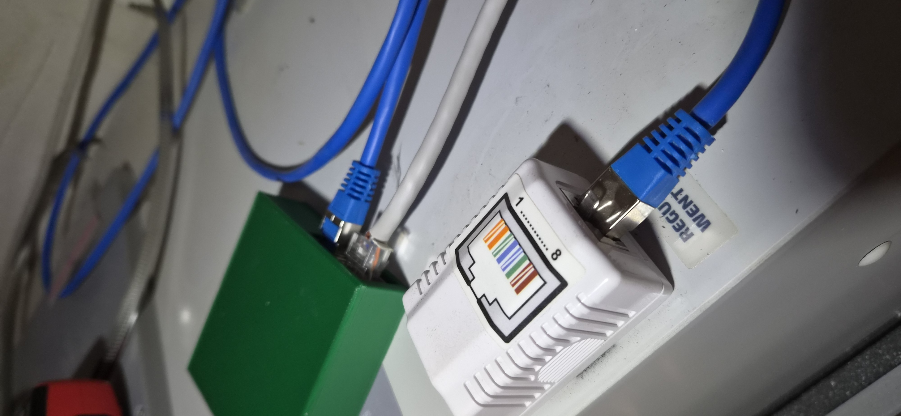
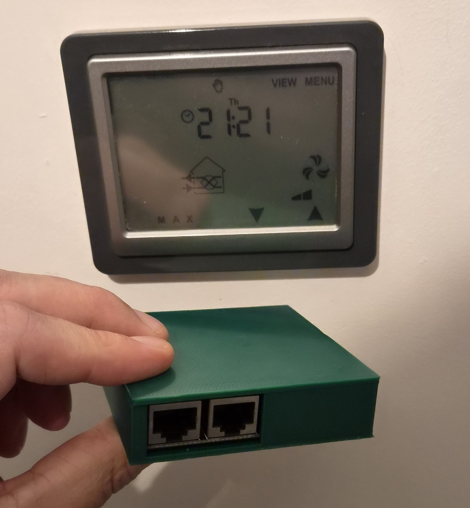
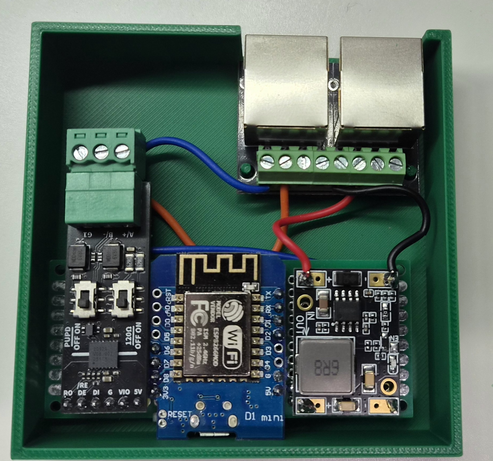
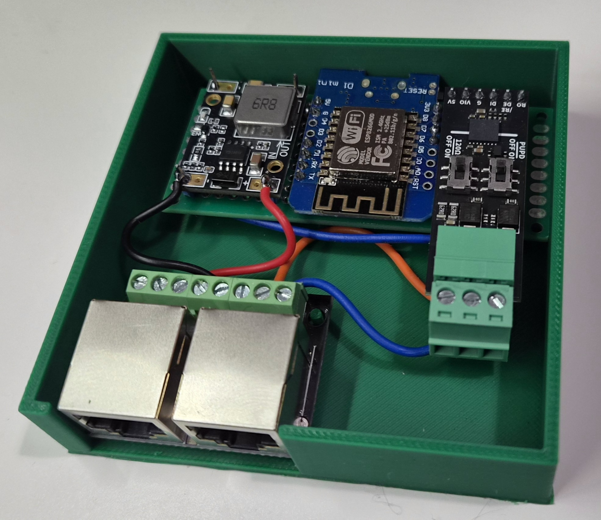
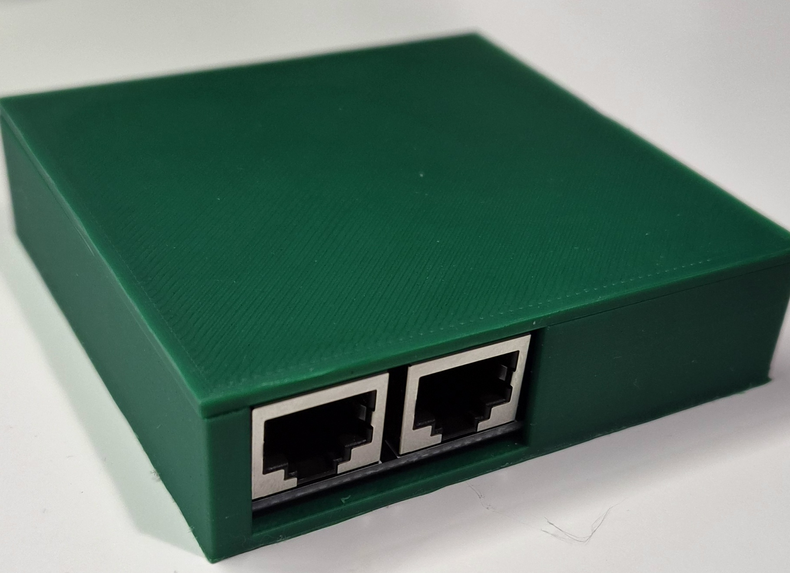

# RC6 Mini Manipulator Emulator for Mistral Heat-Recovery Ventilators

**Home Assistant integration over MQTT.**

ESP8266 firmware for monitoring and controlling a Mistral ventilation unit over
its RS-485 controller bus. It publishes fresh state to MQTT, supports Home
Assistant MQTT Discovery, and accepts safe, confirmed gear and supply-fan
commands.

## Tested system

The project has been tested with a Pro-Vent Mistral 300 ventilation unit, its
S3 control motherboard, and an RC6 Mini manipulator. The S3 motherboard does
not provide a usable Modbus protocol or relay-control interface. This project
uses the controller's RS-485 bus, the available integration path to Home
Assistant for this configuration.

The tested hardware modules and accessories were:

| Component | Tested hardware |
| --- | --- |
| ESP8266 board | Wemos D1 Mini ESP8266 |
| Isolated RS-485 transceiver | WeAct Studio ISO RS485, 0.5 Mbps, 2.5–5.5 V |
| Power supply | WeAct Studio step-down module, 7–24 V input, selectable 3.3/5/9/12 V output, up to 5 A |
| Bus breakout | 8-pin RJ45 breakout board with dual female sockets |

The total cost of all hardware parts was approximately 70 PLN (about €15.61
at the exchange rate on 26 November 2026).

The RJ45 breakout is used as a connector breakout for the controller bus; it
does not imply an Ethernet connection. Verify the Mistral bus pinout and
transceiver wiring before connecting hardware.

## Features

- Configurable controller address (`MISTRAL_PR_NUMBER`, 1-4).
- Continuous RS-485 receive and session-maintenance loop.
- CRC-checked frame parsing and gear decoding for the validated report
  variants.
- MQTT state, availability, and command topics, with reconnect handling.
- Home Assistant MQTT Discovery for gear, connection status, target gear, and
  supply-fan control.
- Stepwise gear changes with report confirmation between steps.
- Fan operation only when the controller has fresh gear-1 and fan-state data;
  menu steps require matching reports before progressing.
- Optional authenticated firmware updates over Wi-Fi.
- HTTP diagnostics at `/status`, `/raw`, `/trace`, `/rx`, and `/parser`.

## Home Assistant demonstration

[Watch the working integration in Home Assistant on YouTube](https://youtube.com/shorts/SVI8-I3RlFA).

## Hardware

- Wemos D1 Mini ESP8266.
- WeAct ISO RS485 transceiver, 0.5 Mbps, 2.5–5.5 V.
- WeAct Studio step-down module, 7–24 V input, selectable 3.3/5/9/12 V output,
  rated up to 5 A.
- 8-pin RJ45 breakout board with dual female sockets.

The following wiring was measured on the author's controller.

**Important:** The manufacturer's documentation labels the RJ45 pins
differently. Verify each RJ45 pin with a multimeter before connecting power
or the transceiver; do not assume standard Ethernet pin assignments. Pin 5 is
left unconnected.



### Power

| From | To |
| --- | --- |
| RJ45 pin 3 (+15 V) | Step-down IN+ |
| RJ45 pin 4 (GND) | Step-down IN− / GND |
| Step-down OUT 5 V | D1 Mini 5V and WeAct 5V |
| Step-down OUT GND | D1 Mini GND |
| RJ45 pin 5 | Not connected |

### RS-485 bus

| From | To |
| --- | --- |
| RJ45 pin 8 (A) | WeAct A |
| RJ45 pin 7 (B) | WeAct B |
| RJ45 pin 4 (GND) | WeAct G |

### Logic (D1 Mini ↔ WeAct)

| WeAct | D1 Mini |
| --- | --- |
| RO | D7 (GPIO13, RX after `Serial.swap()`) |
| DI | D8 (GPIO15, TX after `Serial.swap()`) |
| DE/RE | D1 (GPIO5) |
| VIO | 3V3 |

A 10 kΩ pull-down resistor connects DE/RE to GND on the ESP side.

RJ45 pin 4, WeAct G, step-down GND, and D1 Mini GND are all one common-ground
net. WeAct RS-485 termination and bias are disabled. The firmware uses UART0
at 115200 baud, 8N1, with `Serial.swap()`.

**Do not connect USB and the step-down 5 V output to the D1 Mini at the same
time.** Never connect RS-485 signal wires directly to ESP8266 GPIOs.

The controller address must be unique among connected bus manipulators. The
default is PR1. Choose another address only if it is unused on your bus.

## 3D-printed enclosure

The printable enclosure consists of the [box body](Box.stl) and [cover](Cover.stl).
The photos show the assembled enclosure, the installed electronics, and the
connections to the controller:

<details>
<summary>View enclosure and installation photos</summary>











</details>

## Configure

1. Copy `config.h.example` to `config.h`.
2. Set `WIFI_SSID` and `WIFI_PASSWORD`.
3. Optionally set a unique `OTA_PASSWORD` of at least 16 characters. OTA is
   disabled when this value is shorter or empty.
4. Copy `mqtt_config.h.example` to `mqtt_config.h`.
5. Set the broker IPv4 address, port, and credentials as needed. Leave the
   address empty to build without an active MQTT broker connection.
6. Set `MISTRAL_PR_NUMBER` to the unused address assigned to this controller.

The actual config files are ignored by Git. Never commit Wi-Fi or broker
credentials.

## Build and upload over USB

Install Arduino CLI and the ESP8266 Arduino core. Install the Arduino libraries
`AsyncMqttClient` and `ESPAsyncTCP` (the ESP8266 networking dependency). The
ESP8266 core supplies the HTTP update server library. Compile for the D1 mini:

```powershell
arduino-cli compile --fqbn esp8266:esp8266:d1_mini .
```

Upload over USB, replacing `COMx` with the port for your board:

```powershell
arduino-cli upload --fqbn esp8266:esp8266:d1_mini -p COMx .
```

## MQTT interface

With the default base topic and PR1, the prefix is `mistral/pr1`:

| Topic | Direction | Purpose |
| --- | --- | --- |
| `mistral/pr1/state` | ESP to broker | Non-retained JSON state and command result |
| `mistral/pr1/availability` | ESP to broker | Retained `online` / `offline` availability |
| `mistral/pr1/cmd` | Broker to ESP | Gear or supply-fan commands |

The PR-specific prefix is built from `MQTT_BASE_TOPIC` and
`MISTRAL_PR_NUMBER`. The command payload must be valid JSON with a unique
`request_id` (1-32 ASCII letters, digits, dot, underscore, or hyphen) and
exactly one supported target:

```json
{"request_id":"gear-001","gear":2}
{"request_id":"fan-002","fan":"OFF"}
```

Gear must be an integer from 1 to 4. Fan must be `"ON"` or `"OFF"`. Commands
must not be retained. The firmware rejects malformed, duplicate, retained, or
unsafe requests. Gear changes proceed one step at a time and require fresh
matching bus reports. Fan commands require a fresh gear-1 report and fresh
passive fan-state data.

MQTT Discovery is published under the standard `homeassistant` prefix. The
firmware creates four entities for the configured PR address. State messages
are not retained; availability and Discovery configuration are retained.

## Web diagnostics and OTA

Open `http://<esp-ip>/` on the local network. Useful endpoints:

- `/status` — firmware, bus, MQTT, and control counters.
- `/raw` — latest captured report while running.
- `/raw?index=N` — a stored report sample.
- `/raw?transition=1` — last main-view classification transition, if captured.
- `/trace`, `/rx`, `/parser` — diagnostic data when available.

When `OTA_PASSWORD` has at least 16 characters, firmware upload is available
at `http://<esp-ip>/update` using username `ota` and the configured OTA
password. Build the sketch and select its `.bin` file (not `.elf`). OTA
restarts the ESP8266; a short interruption should allow the bus session to
resume, but verify `/status` afterwards.

The web server and OTA use plain HTTP, not TLS. Use them only on a trusted
local network; do not expose the device or its update endpoint to the Internet.

## Safety and limitations

- This firmware is intended for a private, trusted local network.
- Never operate two manipulators with the same PR address.
- Fan-state monitoring uses fresh reports for this controller's configured
  address; other addresses are not used for its published state.
- If an expected report is not recognized, the firmware reports unknown state
  and blocks commands that require fresh confirmation.
- Verify wiring, address assignment, and device behavior before enabling
  automated control.

## License

MIT. See [LICENSE](LICENSE).
